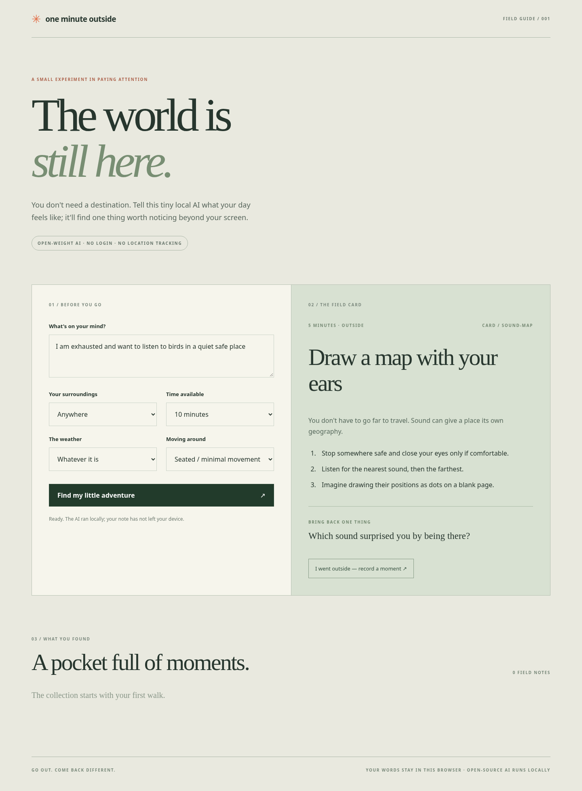

# One Minute Outside

**One minute on your screen. One small adventure outside.**

A local-first, open-weight AI field guide that turns a sentence about your day into a short outdoor observation. Instead of trying to keep you chatting, it gives you a small, practical mission and gets out of the way.



## How it works

1. Describe your mood in one sentence.
2. Choose your surroundings, weather, available time, and whether you need a seated/minimal-movement activity.
3. The browser downloads the open-weight **[all-MiniLM-L6-v2](https://huggingface.co/Xenova/all-MiniLM-L6-v2)** model (Apache 2.0) on first use. **Transformers.js + ONNX Runtime Web** run it locally in a Web Worker.
4. The model ranks 12 original field cards by semantic similarity. Deterministic constraints filter out unsuitable time, location, weather and mobility options.
5. Go outside, notice one thing, and optionally save a note to **your browser's localStorage**.

**Privacy:** no account, geolocation, analytics, server-side inference, API key or mood uploads. An internet connection is needed for the first model download, and the browser may re-download weights if its cache is cleared. Journal entries remain on this device unless you export them yourself.

**Safety:** Observe only from a safe public place. Do not enter traffic, trespass, approach wildlife, or get close to unsafe water edges. Seated mode never recommends a walking-only mission.

## Run locally

Requires Node.js 20+.

```sh
npm ci --ignore-scripts
npm test
npm run build
npm run dev
```

Open the local Vite URL. On most systems, `npm ci` also works; `--ignore-scripts` avoids an optional native image dependency build on Node 26 Linux.

For real open-weight inference in Node, run `npm run smoke` (requires a first-use model download). For actual desktop and mobile Chromium end-to-end checks, run `python3 scripts/browser-smoke.py` after building (requires Python Playwright and Chromium). The browser test verifies local model inference, journal persistence, responsive layout, and absence of unexpected outbound POST requests.

## Static hosting

This is a static Vite app with no backend. Build with the correct project subpath for GitHub Pages:

```sh
npm run build -- --base=/one-minute-outside/
```

Serve the contents of `dist/` from `/one-minute-outside/` on your static host. First-use model downloads come from Hugging Face; no model weights are committed to this repository. The GitHub Pages workflow in `.github/workflows/pages.yml` runs tests and an npm production audit before deploying.

To verify the exact Pages subpath locally (not just the root development URL), run:

```sh
npm run build -- --base=/one-minute-outside/
python3 scripts/browser-smoke.py --base-path /one-minute-outside/
```

The smoke test starts Vite preview with the same base path; otherwise Vite preview can return 404 for the JavaScript bundle even though `index.html` loads.

## Design choices

- **Open AI where it matters:** the model handles semantic meaning, not safety constraints.
- **Explicit constraints:** hard filters for time, weather, setting, and minimal movement.
- **Honest failure:** if local inference cannot load, the UI reports an error rather than claiming a heuristic is AI.
- **Small by design:** no feed, points, location tracking, streaks, or pressure to spend longer in the app.

## Tests and credits

The test suite checks ranking, deterministic tie handling, invalid embeddings, and all hard filters. The integration smoke test has been run with real MiniLM ONNX embeddings (384 dimensions), and desktop/mobile browser flows have passed with Chromium. The model is **Xenova/all-MiniLM-L6-v2**, Apache-2.0 licensed; app source and original field-card text are MIT licensed (see `LICENSE`).

Built in October 2026 as an independent open-source AI experiment for the **DEV / MLH Hacktoberfest Week 1 “Touch Grass”** theme. AI tools assisted in writing and testing the application; the source is available for independent review. This is **not** an entry to WeMakeDevs Mergetober. Contest entry, if any, is a separate action and is not implied by publishing this code.

### Dependency security

The app uses Transformers.js **4.3.1** and Vite 7.3.7 (lockfile-pinned transitive versions). On 2026-10-09, `npm audit` reported **zero known vulnerabilities** after upgrading from Transformers.js 3.8.1. Both desktop and mobile Chromium end-to-end flows were revalidated with actual local ONNX inference after the upgrade. Audit results are time-sensitive and should be rechecked before deployment.
